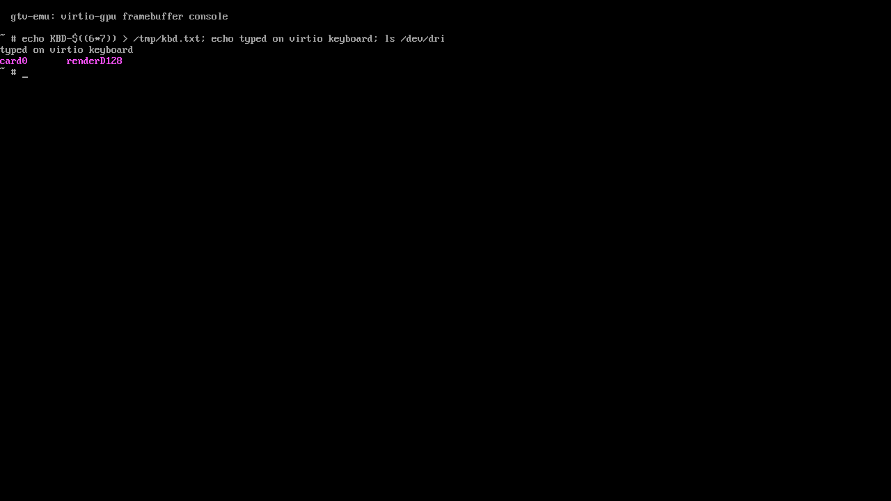

# أجهزة virtio في المحاكي

كل الأجهزة على ناقل virtio-mmio بالإصدار الثاني من الواجهة، ويُنفَّذ الناقل العام والطوابير (virtqueues) في `core/virtio.c`.

| الفتحة | العنوان | الجهاز | الحالة |
|---|---|---|---|
| 0 | `0x0A000000` | قرص virtio-blk | يعمل (قراءة وكتابة وflush) |
| 1 | `0x0A000200` | شبكة virtio-net | يعمل مع بوابة داخلية مبسطة |
| 2 | `0x0A000400` | رسوميات virtio-gpu (2D) | يعمل، مع لقطة شاشة PNG |
| 3 | `0x0A000600` | لوحة مفاتيح virtio-input | يعمل |
| 4 | `0x0A000800` | صوت virtio-snd | يعمل (إخراج إلى ملف WAV) |
| 5 | `0x0A000A00` | شاشة لمس virtio-input | يعمل |

## الرسوميات (virtio-gpu)

- شاشة واحدة بدقة 1280×720، وأوامر الوضع الثنائي الأبعاد: معلومات الشاشة، وإنشاء الموارد وحذفها، وربط ذاكرة الضيف بها، ونقل البكسلات إلى المضيف، والعرض، والتحديث.
- يحتفظ المضيف بنسخة من بكسلات كل مورد، وهي ما سيُرسل لاحقًا إلى Metal على iOS.
- الخيار `--screenshot ملف.png` يحفظ الإطار المعروض عند توقف المحاكي، بكاتب PNG داخلي لا يعتمد على مكتبات خارجية.
- غير منفّذ بعد: التسريع الثلاثي الأبعاد (virgl أو venus أو gfxstream)، وEDID، والموارد المشتركة (blob).

## الإدخال (virtio-input)

- لوحة مفاتيح تعلن عن كل مفاتيح EV_KEY، وتتجاهل طابور الحالة (مصابيح المفاتيح).
- الخيار `--keys "نص"` يكتب النص آليًا عبر لوحة المفاتيح بعد أن يرسل الأمر `\003` ضمن `--feed`، ويستخدمه اختبار الإقلاع للكتابة في طرفية الشاشة الرسومية.
- لم يُنفَّذ بعد: لوحة لمس أو مؤشر بإحداثيات مطلقة، وريموت Android TV.

## الريموت واللمس (virtio-input)

- لوحة المفاتيح تعلن أيضًا مفاتيح ريموت Android TV: ‏HOME (172)، ‏BACK (158)، الأسهم، ‏OK (‏KEY_SELECT = 353، ويقابله DPAD_CENTER في أندرويد)، ‏MENU، وأزرار الوسائط والصوت والقنوات.
- شاشة لمس متعددة اللمسات (البروتوكول B: ‏ABS_MT_SLOT وABS_MT_TRACKING_ID وABS_MT_POSITION_X/Y، مع BTN_TOUCH وINPUT_PROP_DIRECT) بأبعاد 1280×720 مطابقة للشاشة.
- الخيار `--events` ينفّذ سيناريو آليًا يبدأ بالمحرف `\004` في `--feed`، مثل: `key:HOME;key:OK;tap:640,360;swipe:100,300,900,300;wait:500`.
- يقرأ الاختبار الأحداث الخام من `/dev/input/eventN` داخل الضيف ويتحقق من رموزها وإحداثياتها.

## الشبكة (virtio-net مع NAT)

- الواجهة الخلفية في `core/netstack.c`: شبكة مستخدم على غرار slirp، لا تحتاج صلاحيات ولا أجهزة tap، وهو ما يناسب iOS.
- العناوين: الضيف `10.0.2.15`، والبوابة `10.0.2.2` وتمثّل المضيف نفسه (`127.0.0.1`)، وخادم الأسماء `10.0.2.3` ويُحوَّل إلى خادم الأسماء في المضيف (يدعم IPv4 وIPv6).
- المدعوم: ARP، وDHCP، وping إلى البوابة، وUDP (ومنه DNS)، وTCP عبر مقابس المضيف مع نافذة إرسال وإعادة إرسال عند انتهاء المهلة وإغلاق منظّم.
- غير مدعوم بعد: ping إلى عناوين خارجية، وIPv6 داخل الضيف، وتوجيه منافذ من المضيف إلى الضيف.

## الصوت (virtio-snd)

- مخرج PCM واحد بصيغة S16، بتردد 44.1 أو 48 كيلوهرتز، وقناة أو قناتين.
- الخيار `--audio ملف.wav` يحفظ كل ما يشغّله الضيف، وتُعاد مخازن الضيف بإيقاع زمن التشغيل الحقيقي حتى لا يتقدم مؤشر ALSA أسرع من اللازم.
- على iOS سيُستبدل الملف بـAVAudioEngine.
- غير مدعوم بعد: تسجيل الصوت (الإدخال) والمقابس (jacks).

## تعدد المعالجات (SMP)

- الخيار `--smp N` (حتى 4). تُشغَّل المعالجات الثانوية عبر PSCI CPU_ON، ولكل معالج موزّع فرعي في GICv3 ومؤقتات ومقاطعات خاصة، وتعمل المقاطعات بين المعالجات (SGI).
- التنفيذ حاليًا بالتناوب على خيط واحد من المضيف (شرائح من 16384 تعليمة)، فيبقى حتميًا وصحيحًا دون أقفال، لكنه لا يسرّع التنفيذ. التشغيل المتوازي الحقيقي على أنوية المضيف خطوة لاحقة.
- تُلغى مراقبة التعليمات الحصرية عند تبديل المعالج، وتُبطل تعليمات TLBI ذاكرة الترجمة في كل المعالجات.

## التحقق

يتحقق `tests/boot_test.sh` آليًا من ثلاثة وثلاثين بندًا، منها أحداث الريموت واللمس وإقلاع نواة أندرويد GKI (انظر [ANDROID.md](ANDROID.md))، ومنها أيضًا: إقلاع أربعة معالجات وتشغيل أربع مهام متوازية، وبطاقة الرسوميات ولقطة الشاشة، ولوحة المفاتيح، والحصول على عنوان من DHCP، واتصال TCP بخادم على المضيف، وتنزيل صفحة من الإنترنت مع DNS، وتشغيل ملف صوتي عبر aplay ومطابقة ملف WAV الناتج للعينات الأصلية بايتًا ببايت. نجح الاختبار بالمفسّر على x86_64، وبالمترجم الفوري عبر qemu-aarch64.

